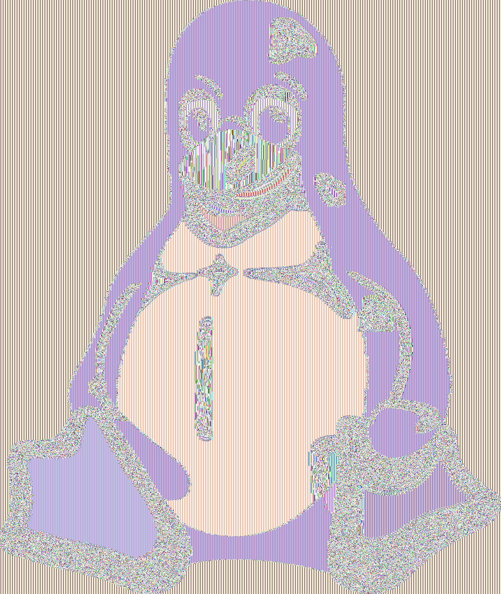
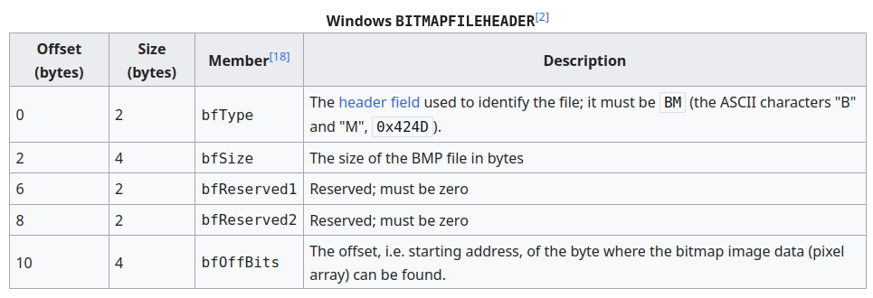
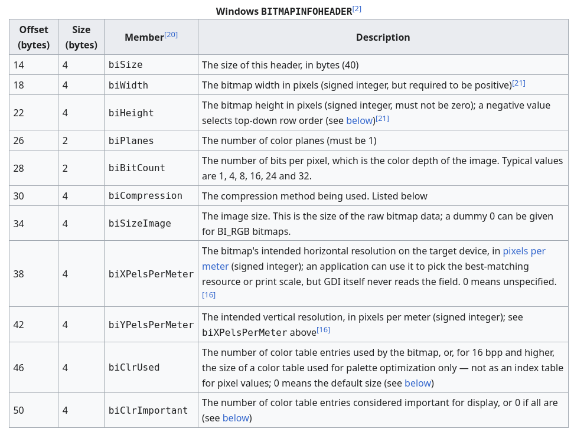
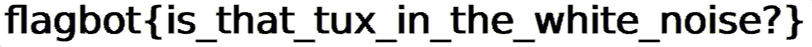

# Challenge overview
This cryptography challenge has the following description:
```
Relax your eyes. Look through the ciphertext, not at it.
```
This seems cryptic as usual... We are provided with a `chal.py` script and a `flag.bmp.enc` that seems to contain garbage values when opened.

A look at `chal.py` explains what is going on: `flag.bmp.enc` is an encryption of the flag image file in the bmp format using AES ECB mode. 

# Why using ECB Mode is (almost always) not a good idea
Admittedly, it helps a lot to have already solved a similar challenge before to quickly figure out what is wrong here: ECB is notorious for being a bad block cipher to use since the same message block will always get mapped to the same ciphertext block.

One famous example is the Linux Tux penguin being encrypted with ECB mode enabled:

<div style="display: flex; gap: 20px; align-items: flex-start;">


</div>

Source: [https://en.wikipedia.org/wiki/Block_cipher_mode_of_operation](https://en.wikipedia.org/wiki/Block_cipher_mode_of_operation)

As we can see, repeated plaintext blocks get mapped to repeated ciphertext blocks under this encryption mode.

With this in mind, the task became clear: map the ciphertext block which occurs with the highest frequency to the color white, i.e., the background. Then map all other ciphertext blocks to the color black, and then open the image and hopefully find the flag.

# A small detour to learn about BMP files
Understanding the assertions from the challenge file requires us to first make ourselves familiar with that image format. As is often the case in CTFs, Wikipedia is our friend. This Windows bitmap format is used to store two-dimensional images and the file header is composed as such:



Source: [https://en.wikipedia.org/wiki/BMP_file_format](https://en.wikipedia.org/wiki/BMP_file_format)


In particular, we learn that the `bmp` file has a predictable header size of 14 bytes, which corresponds to the first four assertions in `chal.py`.

What we do not learn from the assertions, unfortunately, is the value of `bfSize`.

These assertions reveal another clue:
```python
assert read(data[10:14]) == 54 # image data starts at file offset 54 
assert read(data[14:18]) == 40 # normal BITMAPINFOHEADER header
```
The first assertion above corresponds to the `bfOffBits` entry in the bitmapheader table, meaning that the bitmap image data starts at byte 54 as the comment suggests. The second assertion above also confirms that this file header is followed by a `bitmapinfoheader`:



Source: [https://en.wikipedia.org/wiki/BMP_file_format](https://en.wikipedia.org/wiki/BMP_file_format)

We can now confirm that the comments are accurate: the image consists of a single plane, and there is 'no fancy color table stuff' as the comments suggest. We also learn that the width of the image is more than 16 times its height: 
```python
assert read(data[18:22]) > 16*read(data[22:26])
```

One last fact we can note about bmp files is that color table entries consist of 4 bytes (RGBQUAD). 

We will assume that the original image used 24-bit RGB, as this is by far the most common choice.


# Some (small) obstacles, followed by an exploit
But wait, what are the exact dimensions of the image? Unfortunately, this info is not provided to us, and we will have to guess the height of the image.

Another problem is that we do not know the size of padding that was used to encrypt the last block. The challenge pads the plaintext to a multiple of 128 bytes before encrypting it:
```python
data = cipher.encrypt(pad(data, 128))
```
Since we don’t know the original BMP size, we have to brute force how many padding bytes to exclude when reconstructing the image.

With all of this in mind, let's find our flag!

We will start by finding the background color from the encryption file as mentioned above. 

We can forget about the bmp header for our purposes and create an image with the Python library Pillow from a byte array we will create from the encrypted byte blocks.

We can then iterate over all possible height and padding lengths within some bounds that can be tweaked with trial and error:
```python
for height in range(50, 300):
    for padding in range(1, 129):
        [...]
```
At this point, I noticed that we need to eliminate most pairs in order to avoid having to go through so many images by hand. These three checks are:
- If the height does not divide the total size (calculated as the size of the encryption minus 54 for the headers minus the guessed padding size), we can already reject this candidate pair.
- If the row size is not a multiple of 4 bytes or the resulting width is not more than 16 times the height, we can also throw away these candidate parameters.
- We only need unique width-height pair, as further changing the padding of the last block almost certainly won't help us in any way.

The exploit with additional details in the comments can be found in `solution.py`, and after running it, image `2684x159.png` gives us the flag:


