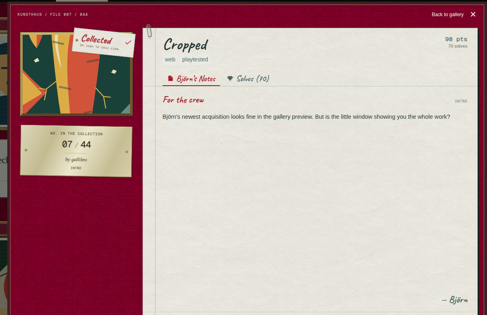
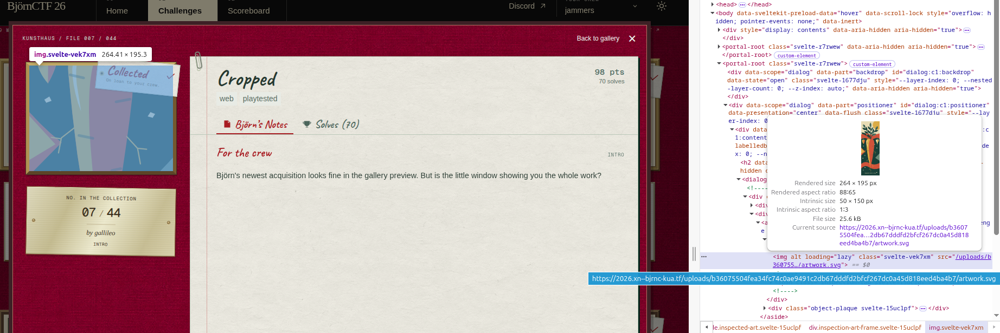
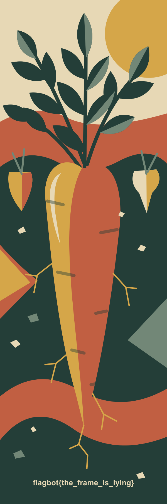

# Challenge description and solution
The following is a nice warmup challenge for quick points. We only get a short challenge description:

Keeping in mind that the title is of this challenge is `Cropped`, we can open our trusted web dev tools with `F12` and inspect the image to the left. 

Opening the image in a new tab gives away the flag, allowing us to complete the challenge:

