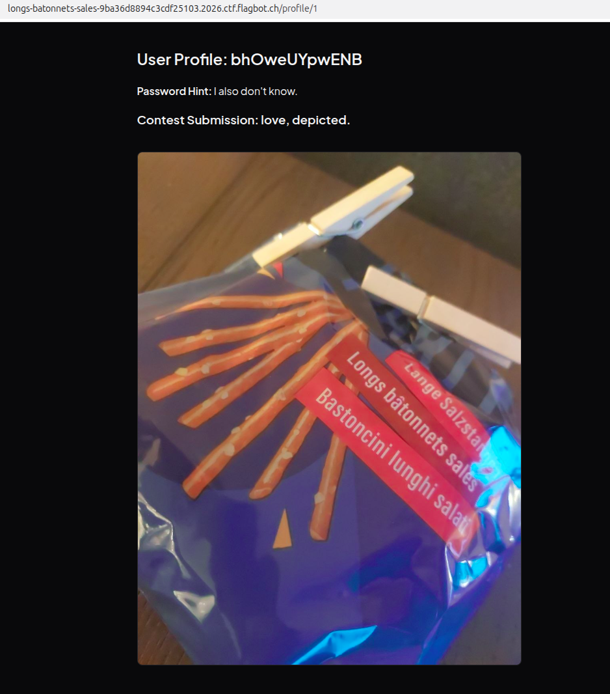

# Challenge overview
This challenge consisted of a Flask website with a Jinja2 templating engine (which Flask uses per default) where users can submit pictures. The following features and endpoints were implemented:
- A user can register a new account using the `/signup` endpoint. In addition to a username and password, a password hint can be set, which is not especially relevant when solving the challenge.
- A `/login` endpoint for logging in.
- A `/logout` endpoint to end the session.
- A user can submit a picture using the `/submission` endpoint. The picture is then stored as a BLOB in the backend database. 
- The submitted picture (as well as the password hint) is displayed upon accessing the `/profile/<int:uid>` endpoint. For this, the BLOB is turned into a base64 encoding.

Upon starting the server, a cryptographically secure random flag identifier is created, and the flag is extracted from the docker environment variable, and then stored as a config variable fo the Flask app. A user is then created with the flag identifier as the username and the flag as a password.

# Vulnerabilities
Taking a first look at the SQL database commands yields disappointments:
```sql
user = db.execute(
            "SELECT * FROM users WHERE username = ?", (username,)
        ).fetchone()

```
The user inputs are cleanly separated from the SQL commands, which makes SQL injections impossible.

Let's see where else user input lands... A few `CTRL+F` commands later, we can see that the user controlled input `title` is directly injected into the template without proper sanitization:
```python
def profile_template(photo_base64, title):
    return LAYOUT.replace(
    "",
    """
    
        <p style="visibility: hidden"><strong>Debug: App Name:</strong> {{ app.name }}</p>
        <h2>User Profile: {{ profile_user.username }}</h2>
        <p><strong>Password Hint:</strong> {{ profile_user.secret_text }}</p>

        <h3>Contest Submission: """+title+"""</h3>
        
            
        
            <p>No photo submitted yet.</p>
        
    
    """
    )

```
There is a check on the filename though, but it does not what we would expect it to do. Instead of checking for a valid image file extension, the regular expression accepts any string with the characters inside the brackets below at any location (in particular `{` and `}`):
```Python
def is_filename(filename):
    if filename is None:
        return False
    if filename == "":
        return False
    if not re.fullmatch(r'^[a-zA-Z0-9.{jpeg,jpg,png}]+$', filename):
        return False
    return True

```

We will keep in mind that we can insert Jinja expressions using the `title` of a picture we upload, since the delimiters `{{...}}` are not filtered out from the file name.

Next, after trying out the aforementioned features of the challenge website, we notice that the URL of the profile page is simply `[X]/profile/2`. Suspecting that the mapping from database user ids to URL `uidd` is just the identity mapping, sure enough: 

This imported library is left unused:
```python
import uuid
```
Later on:
```python
@app.route("/profile/<int:uid>")
def profile(uid):
    db = get_db()
    profile_user = db.execute(
        "SELECT id, username, secret_text FROM users WHERE id = ?", (uid,)
    ).fetchone()
```

We see that the id value of the database is defined as follows:
```SQL
CREATE TABLE IF NOT EXISTS users (
    id INTEGER PRIMARY KEY AUTOINCREMENT,
    username [...],
    password_hash [...],
    secret_text [...]
)
```
Indeed, that is an insecure direct object reference (IDOR), and in the real world we would want to use difficult-to-guess UUIDs as user references instead in addition to ensuring that each user can only access their own profile with authorization checks.


# Exploiting what we found 
In a first step, we can create a user account, and any credentials will do for our purposes.

Next, accessing `[X]/profile/1` gives us the profile of the bot (since that is how the database was initialized) and in particular we are greeted with the username of the bot account, which is also the flag identifier:



Next, we can upload any image under the `/submission` page with the following title:
```
{{app.config.bhOweUYpwENB}}.jpeg
```

The flag will then appear as the file name of the image, concluding our challenge!

The flag is:
```
flagbot{17_wou1D_B3_very_b0R1n6_to_63t_a_F146_Wi7h0ut_4ny_1eetsP33ch_iN_i7_WH475oeV3r}
```